# FormSure

**Check your MahaDBT scholarship application before you submit: Gemini reads your documents, plain rules decide, and you see exactly what to fix, in English, Marathi or Hindi.**

**Live:** https://formsure-de6fa.web.app  (Firebase Hosting, free Spark plan)  ·  Hackathon track: Education & Student Life

> **Gemini reads, code decides.** The AI only turns a scan into structured JSON. Every pass/fail verdict comes from a deterministic rules engine that runs in your browser against a versioned *scheme pack*, so each verdict is explainable and links to its source.

## Screenshots

Sample applicant "Aarav Sunil Patil" (fictional). All screenshots are from the built app.

| Landing | Scheme picker | Upload |
|---|---|---|
| 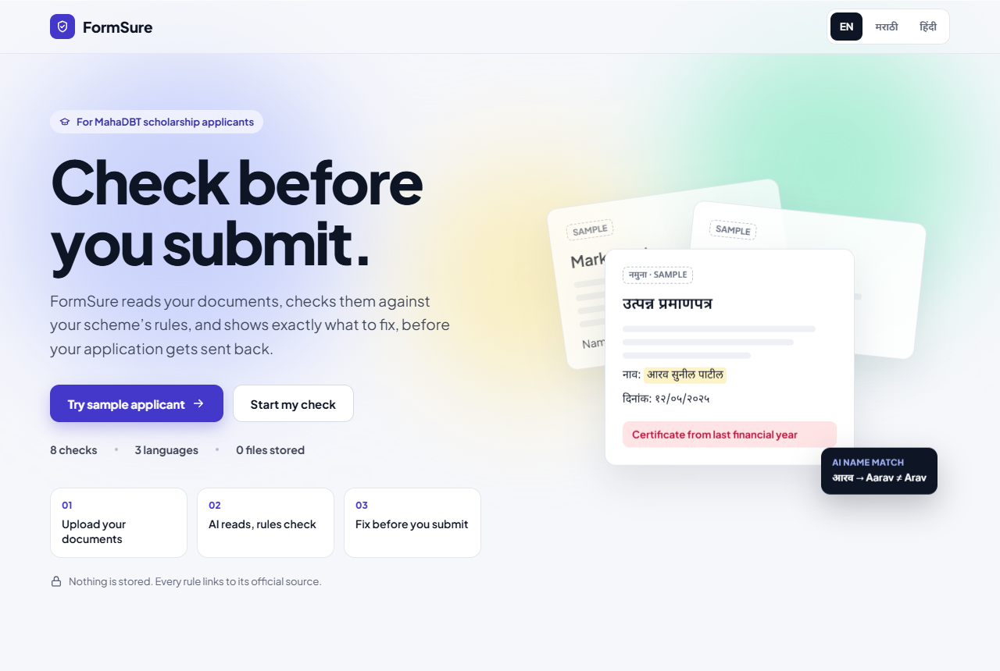 | 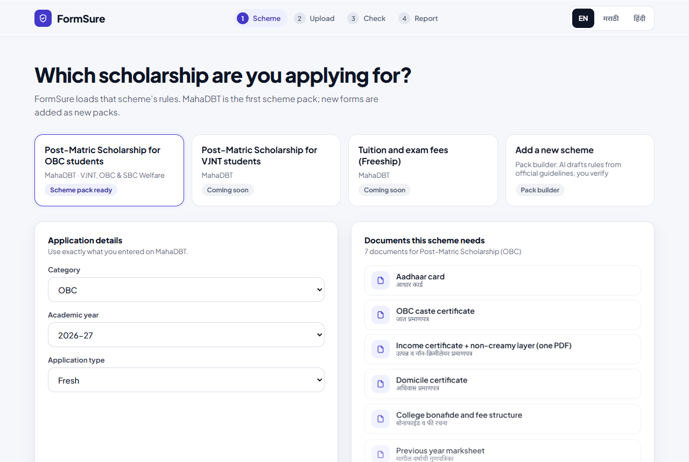 | 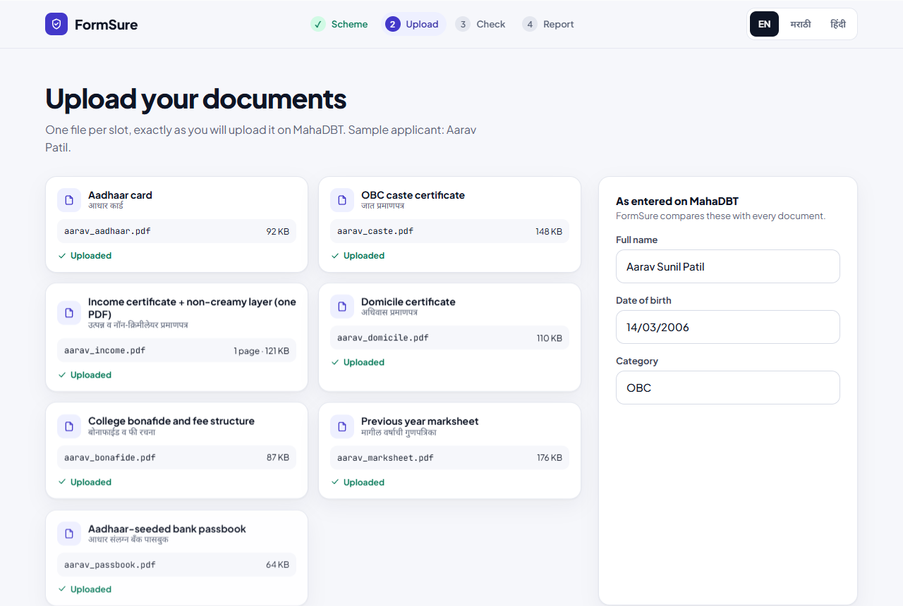 |

| Live audit | Readiness report | Ready (100 %) |
|---|---|---|
| 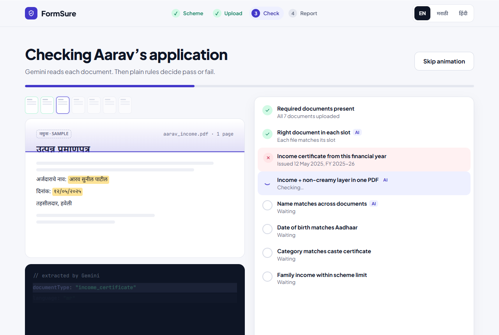 | 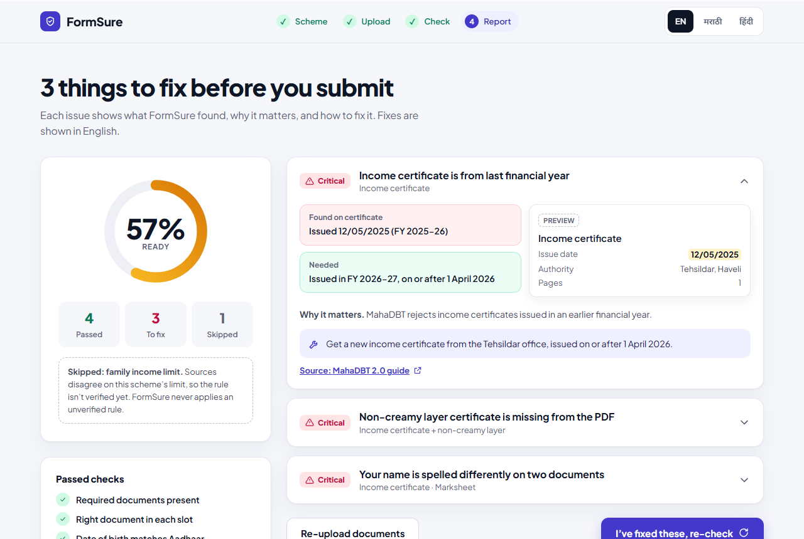 | 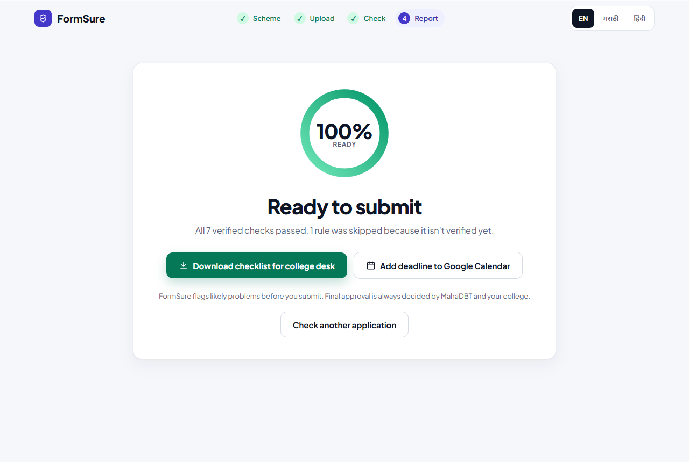 |

| Printable checklist | Phone: landing | Phone: scheme picker |
|---|---|---|
| 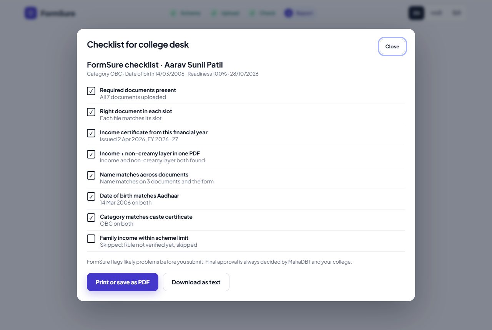 | 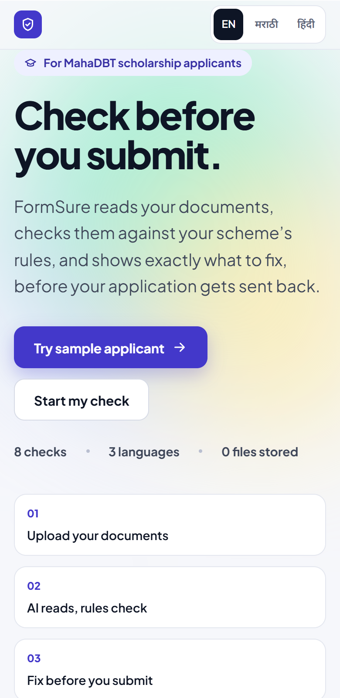 | 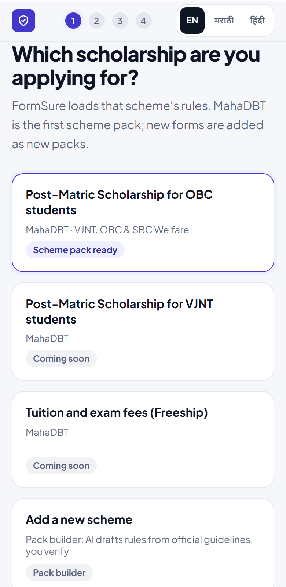 |

## The problem

A MahaDBT application can be sent back for a mistake that is easy to prevent but hard to see: an income certificate from the previous financial year, a non-creamy-layer certificate missing from the income PDF, or a name spelt *Arav* on one document and *Aarav* on another. The student usually learns this only after submission, with a generic rejection, and has to wait for the next window.

The rules FormSure checks come from public guides and a college notice, not from an official machine-readable spec:

- Required documents for the Maharashtra Post-Matric OBC scheme: [IndiaScholarships guide](https://www.indiascholarships.in/hi/scholarships/maharashtra-postmatric-obc)
- Income certificate must belong to the current financial year: [MahaDBT 2.0 guide](https://anantamias.com/mahadbt/)
- OBC / SBC / VJNT applicants upload income + non-creamy-layer together: [college scholarship notice (Vaze College, 2025-26)](https://vazecollege.net/wp-content/uploads/2026/02/Notice-for-Reserve-Caste-Cetogary-Students-SFC-for-2025-26.pdf)
- Names and details must match across documents: [CareerIndia, MahaDBT verification steps](https://www.careerindia.com/news/mahadbt-1-0-portal-closing-today-urgent-scholarship-verification-steps-2026-011-65787.html)

See [Honest limitations](#honest-limitations): these have not yet been checked against the official scheme document.

## Who it is for

- **Applicants**, first-generation students above all, who apply on a phone and read Marathi or Hindi more comfortably than English.
- **College scholarship desk staff** who help many students and can use the printable checklist to see what is ready.

## How it works

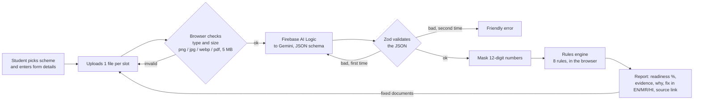

1. Pick the scheme and enter the details exactly as on MahaDBT.
2. Upload one file per slot (7 slots). Each file is checked in the browser, then sent only to Gemini through Firebase AI Logic with a response schema.
3. The answer is validated with Zod and retried once on bad JSON or a timeout; after that a friendly error is shown.
4. The rules engine runs over the extracted JSON. `readiness = passed ÷ applied checks × 100`; skipped rules are not counted.
5. The report shows each issue with the evidence found, why it matters, the fix in the chosen language, a mini preview of the document with the problem field highlighted, and a link to the source of the rule.

**Try sample applicant** runs the same engine on fictional data with no network and no Firebase config: **50 %** with 1 scored issue (income + non-creamy layer merged PDF) plus 1 advisory warning (the marksheet says *Arav*, the form says *Aarav*), then **100 %** after "I've fixed these, re-check" (under evidence-gated rules where only verified rules with official or college-notice evidence are evaluated).

## The 8 rules

Each rule carries a register status:

- **`verified`** (official source or college notice): applied and **scored**.
- **`pending`** (secondary sources only): still run, but as an **advisory warning**. The student sees the result ("Check manually: name on marksheet"), but it never changes the readiness score or the pass/fail totals.
- **`conflicting`** (sources disagree): skipped and shown as *not evaluated*, never guessed. This table matches the shipped JSON packs exactly (`npm run rules:register` regenerates [RULES.md](RULES.md) from them).

| # | Rule | Checked by | OBC pack | SC pack |
|---|------|------------|----------|---------|
| 1 | Required documents present | Code | conflicting: skipped | conflicting: skipped |
| 2 | Right document in each slot | AI reads, code decides | **verified: scored** | pending: advisory |
| 3 | Income certificate issued in the current Indian financial year (1 Apr – 31 Mar, IST) | Code | conflicting: skipped | conflicting: skipped |
| 4 | OBC / SBC / VJNT: income slot holds income certificate **and** non-creamy layer | AI reads, code decides | **verified: scored** | n/a |
| 5 | Name matches the form across Aadhaar, income certificate, marksheet | AI reads, code decides | pending: advisory | pending: advisory |
| 6 | Date of birth matches Aadhaar | Code | pending: advisory | pending: advisory |
| 7 | Category matches caste certificate | Code | pending: advisory | pending: advisory |
| 8 | Family income within limit | Code | conflicting: skipped | **verified: scored** (₹2,50,000) |

Every rule type is implemented and fully tested (`src/core/engine.test.ts` runs all of them with a test pack that marks them verified). Promoting a rule from advisory to scored is a data change, not a code change: set `status: "verified"` once an official source or college notice backs it.

"AI reads, code decides" means Gemini supplies the extracted field (document types, transliterated name); the verdict is still computed by code.

**Name matching (rule 5).** English documents must match the form exactly after normalising case and spaces. Marathi and Hindi documents compare a phonetic key (`aa→a`, `ee→i`, `oo→u`, `w→v`) of Gemini's English transliteration. So *आरव → Aarav* passes against *Aarav* on the Marathi income certificate, while an English marksheet that says *Arav* fails.

## Architecture

A static site. No server, no Cloud Functions, no database. Firebase Spark (free) plan.

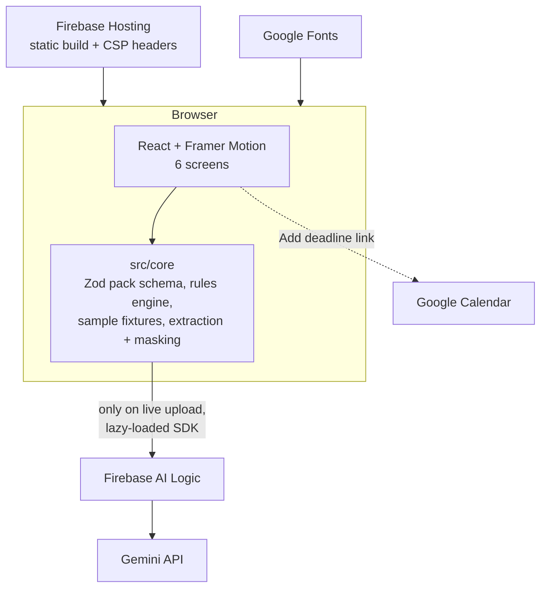

```
src/core/           runs in the browser
  schema.ts           Zod schema + validated scheme pack
  schemes/*.json      the scheme pack (rules)
  engine.ts           runAudit(pack, form, documents, now)
  sample.ts           fictional fixtures (error + fixed)
  rules/*.ts          one evaluator per rule type
  fileValidation.ts   type, size, magic bytes, PDF and image checks
  mask.ts             12-digit (Aadhaar) masking and log-safe errors
  preview.ts          which field of which document an issue is about
src/services/
  extraction.ts       Zod validation of Gemini output, 429 backoff, timeout retry
  firebase.ts         Gemini via Firebase AI Logic + App Check (lazy-loaded)
  rateLimiter.ts      client-side request limiter
  readFiles.ts        reads files two at a time, per-slot retry
  uploadPipeline.ts   validation, EXIF stripping and downscaling before upload
  types.ts            shared types
src/screens/        Landing, Scheme, Upload, Audit, Report, Ready (+ Modal, Ring, Confetti)
src/                App, glue (api.ts), ErrorBoundary, Framer Motion helpers, styles.css
public/             favicon, apple-touch icon, web manifest
firebase.json       Hosting: public = dist, SPA rewrite, security headers
```

## Why AI is essential

- **Reading scans.** Applicants upload phone photos and PDFs of Marathi, Hindi and English documents. Classical OCR plus hand-written parsers would need one template per issuing authority. Gemini reads the page, recognises which document(s) a PDF contains (an income certificate *and* a non-creamy-layer certificate in one file), and returns typed fields.
- **Marathi → English name matching.** The same person is written *आरव सुनील पाटील* on a Tehsildar's certificate and *Aarav Sunil Patil* on the form. Comparing the English transliteration with a phonetic key lets the engine pass legitimate spelling variants of a Devanagari name and still catch a real mismatch.
- **Why not let the AI judge?** A model that decides "ready or not" cannot cite a source or be audited. Here the model never decides; code does, and each rule is tested.

## Scheme packs

A pack is one JSON file (`src/core/schemes/mahadbt-postmatric-obc.2025-26.json`) validated with Zod when the app starts. It has `slots` (the documents, with names in en / mr / hi and the document types each slot accepts) and `rules`. Every rule has an `id`, a `type`, a `label`, a `severity`, `why` and `fix` text in three languages, a `source` (label, URL, kind), `verified`, and `usesAi`.

Supported rule types: `required_document`, `document_check`, `date_window`, `conditional`, `cross_document_match`, `field_consistency`, `numeric_max`.

To add a scheme:

1. Copy the JSON file and edit `slots` and `rules`. Reuse existing rule types; a new kind of check means one new `case` in `src/core/engine.ts` plus a Zod schema entry in `src/core/schema.ts`.
2. Put the official source for every rule in `source`. Leave `verified: false` until a person has compared the rule with that source. Unverified rules are skipped, never applied.
3. Add tests for the new rules (see `src/core/engine.test.ts`).
4. Register the pack in `src/core/schema.ts`.
5. Run `npm run rules:register` to update `RULES.md`.

**Shipped packs:** FormSure ships with two verified scheme packs: **Post-Matric OBC** (`mahadbt-postmatric-obc.2025-26.json`) and **Post-Matric SC** (`mahadbt-postmatric-sc.2025-26.json`, with verified annual income limit of ₹2,50,000 backed by college notices). The Scheme screen allows switching between them dynamically in live mode. Additional schemes (VJNT, Freeship) are marked for future pack releases.

## Google services used

- **Gemini via Firebase AI Logic** (Gemini Developer API backend): document reading with structured JSON output
- **Firebase Hosting**: serves the static build with security headers
- **Google Fonts**: Plus Jakarta Sans, Noto Sans Devanagari, JetBrains Mono
- **Google Calendar**: "Add deadline to Google Calendar" link on the Ready screen

## Security and privacy

Details in [SECURITY.md](SECURITY.md).

- **No storage.** There is no backend and no database. Files are read in memory, sent once to Gemini through Firebase AI Logic, and dropped when the page closes.
- **Aadhaar masking.** Any 12-digit number in model output or in the report is rewritten to `XXXX XXXX 1234` before it is displayed or printed.
- **App Check with reCAPTCHA Enterprise protects the Gemini quota.** The app initialises App Check before Firebase AI Logic, so each Gemini request carries a token that only this site can obtain (set `VITE_RECAPTCHA_SITE_KEY`, register the site key and the web app in the Firebase console, and enforce App Check for AI Logic). In dev it uses an App Check debug token printed in the browser console, which you register once in the console.
- **File validation** in the browser: png / jpg / webp / pdf only, 1 byte to 5 MB, before anything is sent.
- **Zod on AI output.** Invalid output is retried once, then rejected with a friendly message.
- **CSP and headers** from Firebase Hosting: `script-src 'self'` plus Google's reCAPTCHA scripts (`www.google.com`, `www.gstatic.com`), `frame-ancestors 'none'`, `nosniff`, `Referrer-Policy: no-referrer`; connections limited to `*.googleapis.com` and `www.google.com`; reCAPTCHA frames from Google only.
- **No secrets in the repo.** `.env` is git-ignored; `VITE_FIREBASE_*` are public web identifiers.
- Only **fictional** sample data is included.

## Accessibility

Target: **WCAG 2.1 AA**.

- Real buttons, labels and landmarks; keyboard-operable file inputs; dialogs take focus, make the page behind them `inert`, trap Tab, close on Escape and return focus to the opener.
- `aria-live` regions for audit progress, a `progressbar` role, severity shown as icon + word + colour.
- **axe tests** (`vitest-axe`) run on every screen and both dialogs with no violations.
- **Contrast** (computed from the palette): body text 9.3:1 to 17:1, muted text on white 5.9:1, status colours on their tints 4.84:1 to 7.3:1, white on indigo 7.9:1. The lowest pair is green on its tint at 4.84:1. jsdom cannot measure contrast, so the Playwright suite checks it in a real browser.
- **Reduced motion.** `useReducedMotion` turns off every Framer Motion animation and the CSS transitions: results appear immediately, no confetti, no ambient drift.
- **Three languages.** EN / मराठी / हिंदी toggle changes fixes, "why it matters" and document names, and sets `<html lang>`; Marathi and Hindi fragments carry their own `lang`.
- Works at phone width: one compact header row, step numbers only below 640 px; verified with no horizontal overflow at 390 px.

Not done: a full screen-reader pass with NVDA / VoiceOver. axe catches structural problems, not whether the experience is good.

## Testing

`npm test` runs **270 unit and component tests in 28 files**. `npm run test:e2e` runs **Playwright** against the production build on desktop and a phone viewport: the whole sample flow, a real-browser **axe** scan (WCAG 2.1 AA, including colour contrast) on every screen, and a no-horizontal-scroll check at 390 px. (Vitest, jsdom, Testing Library, vitest-axe). `npm run test:coverage` adds coverage with a threshold on `src/core`.

| Coverage | Statements | Branches | Functions | Lines |
|---|---|---|---|---|
| `src/core` (rules engine, validation, masking, preview) | 99.6 % | 91.6 % | 100 % | 99.7 % |
| Whole `src` | 95.5 % | 86.6 % | 94.5 % | 97.3 % |

What is covered:

- Every rule type; Indian financial-year edges (31 March vs 1 April, and the IST boundary at 20:00 UTC); unverified rule skipped; missing or unreadable data skipped, not guessed.
- SC scheme pack rules including verified ₹2,50,000 family income limit.
- Evidence-based rules register (`RULES.md`) validated against test suite.
- Error fixture = exactly **1 failure, readiness 50**; fixed fixture = **100**.
- Multi-scheme selection between OBC and SC packs, locking sample mode to OBC.
- File validation, magic-byte checks, canvas EXIF stripping & downscaling.
- Aadhaar masking, Gemini retry-then-success, 429 backoff, rate limiter in `sessionStorage` and concurrency pool (2 reads at once).
- Dialogs: focus moves in, background is `inert`, Tab wraps both ways, Escape and outside click close, focus returns to the opener; checklist print and text download.
- Issue previews: the highlighted field for every rule with a preview.
- UI: issues rendered, language toggle and `html lang`, skip link, screen-reader score descriptions, dialogs, printable checklist, reduced-motion path, ErrorBoundary.
- Accessibility: axe on every screen with zero violations, in jsdom and in a real Chromium browser (Playwright), where colour contrast is checked too.
- Advisory rules: pending rules run and are shown, but never change readiness or the scored totals.

CI (`.github/workflows/ci.yml`) runs lint, typecheck, `test:coverage`, build and the Playwright browser tests on every push.

```bash
npm test                # all tests
npm run test:coverage   # with coverage report
npm run test:e2e        # Playwright + axe in a real browser (run `npx playwright install chromium` once)
npm run lint            # ESLint, zero warnings (includes jsx-a11y)
npm run typecheck
```

## Performance

Vendor code is split so no chunk exceeds 500 KB (largest: 216 KB). The Firebase SDK is loaded only when someone uploads a file for live reading, so the sample flow never downloads it.

| Chunk | Raw | Gzip | Loaded |
|---|---|---|---|
| `react` | 210.5 KB | 65.7 KB | on start |
| `framer-motion` (`LazyMotion` + `domAnimation`, `m.*` components) | 96.5 KB | 34.4 KB | on start |
| app (`index`, includes both scheme packs) | 215.5 KB | 58.9 KB | on start |
| `firebase` (app + AI Logic + App Check) | 95.2 KB | 29.1 KB | lazy, live upload only |
| CSS | 18.8 KB | 4.7 KB | on start |

Initial JavaScript is about 523 KB raw / 159 KB gzip. `LazyMotion` cut the animation chunk by 40 %. I have not run Lighthouse or measured real-device load times.

## Run and deploy

Requires Node 22.

```bash
npm install
cp .env.example .env         # optional: Firebase web config for live reading; the sample works without it
npm run dev                  # Vite dev server on http://localhost:5173
npm run build && npm start   # production build preview
```

Live reading needs a Firebase project with **Firebase AI Logic** enabled (Gemini Developer API provider), a registered web app, and **App Check** (reCAPTCHA Enterprise) enforced for AI Logic. Copy its config into `.env` **before building**, because `VITE_*` values are compiled into the bundle:

```
VITE_FIREBASE_API_KEY=  VITE_FIREBASE_AUTH_DOMAIN=  VITE_FIREBASE_PROJECT_ID=  VITE_FIREBASE_APP_ID=
VITE_RECAPTCHA_SITE_KEY=   # reCAPTCHA Enterprise site key for App Check
VITE_GEMINI_MODEL=gemini-3.8-flash
```

If the config is missing, live upload shows "Live reading unavailable, try the sample applicant" and the sample flow still works.

Deploy to Firebase Hosting (project `formsure-de6fa`, set in `.firebaserc`):

```bash
npx firebase-tools login
npx firebase-tools deploy --only hosting     # predeploy runs npm run build
```

The build tooling in this repository never deployed the site; the live link above works once you deploy.

## AI tools used and how I prompted

- **Claude Code** wrote most of this codebase, tests and docs.
- **Gemini** (through Firebase AI Logic) is used at runtime for document reading only.

How the work was directed:

1. **A fixed design as the contract.** A clickable prototype (`design/formsure-design.html`) was the visual and behavioural reference: port its CSS, copy and six screens exactly, replace the hard-coded data with real calls.
2. **Principle first.** "Gemini reads, code decides" was stated up front and shaped the architecture: a rules engine with sources, a `verified` flag, and AI output that is only ever data.
3. **Explicit fixtures and numbers.** The brief fixed the sample applicant, its expected results (50 % with one issue, then 100 % after the fix) and the rule order, so tests could pin them.
4. **Tests as gates.** Each part was committed only after lint, typecheck, tests and build passed.
5. **Changing constraints.** The deployment target changed twice during the build (Cloud Run, then Cloud Functions, then a static site); the architecture was reworked each time, which is why the engine moved into `src/core`.

The prompt text is not reproduced here. Review the code, not the prompt: everything above is checked by tests.

## Honest limitations

- **Evidence & verification status:** The OBC income-limit rule is skipped because authoritative sources conflict (₹2.50L official portal vs ₹1.50L MIT notice vs ₹8L Tirpude notice) and remains disabled until reconciled. The SC scheme pack income limit is verified at ₹2,50,000 backed by the official MahaDBT portal and supporting notices. Both scheme packs are confirmed for academic year 2025-26.
- **Visual document redaction is not implemented,** so the upload screen tells the student before they consent: the whole scan, Aadhaar number and QR code included, goes to Gemini, and they can cover the first 8 digits and the QR code first because FormSure needs only the name and date of birth. In detail: Text-level 12-digit number masking (`maskAadhaar`, `maskDeep`) is applied across all extracted model outputs, reports, logs, and filenames. However, pre-transmission visual redaction of scanned images or PDFs (such as drawing black bars over card numbers or QR codes) is not implemented; raw scans are sent to Gemini for OCR reading, stripped of image EXIF metadata only.
- **Client-side rate limiter is a usability safeguard:** `sessionStorage` timestamps are scoped to a single tab and provide reload persistence within that tab only. Authoritative abuse prevention and quota enforcement relies on provider-side Firebase App Check (reCAPTCHA Enterprise) and Google Cloud project quotas.
- **The live Gemini path has only been tested with mocks.** The App Check setup is mocked too. No Firebase project or key was used by the automated tests. Check the model name (`gemini-3.8-flash`) and the response schema against your own project before relying on it.
- Extraction quality depends on scan quality, and transliteration-based name matching is a heuristic: it can pass a near-miss or flag a valid variant.
- Documents are sent to Google's Gemini API for reading. "Nothing is stored" describes FormSure, not Google's own data handling for your project.
- **FormSure flags likely problems. It does not guarantee approval.** The decision rests with MahaDBT and the college.
- Accessibility was checked with axe and a computed contrast table, not with real assistive-technology users.

## Future work

- **More scheme packs** (VJNT, Freeship, other states), with a pack selector and an AI-assisted pack builder where a person verifies every drafted rule against the official source.
- **Verify the rules** against the official scheme documents and resolve the income-limit conflict, then enable rule 8.
- Per-user rate limits on top of App Check, and App Check replay protection.
- **College desk dashboard** to review many students' checklists (with explicit consent and a real privacy design).
- Screen-reader testing, offline support for the sample, and more languages.
